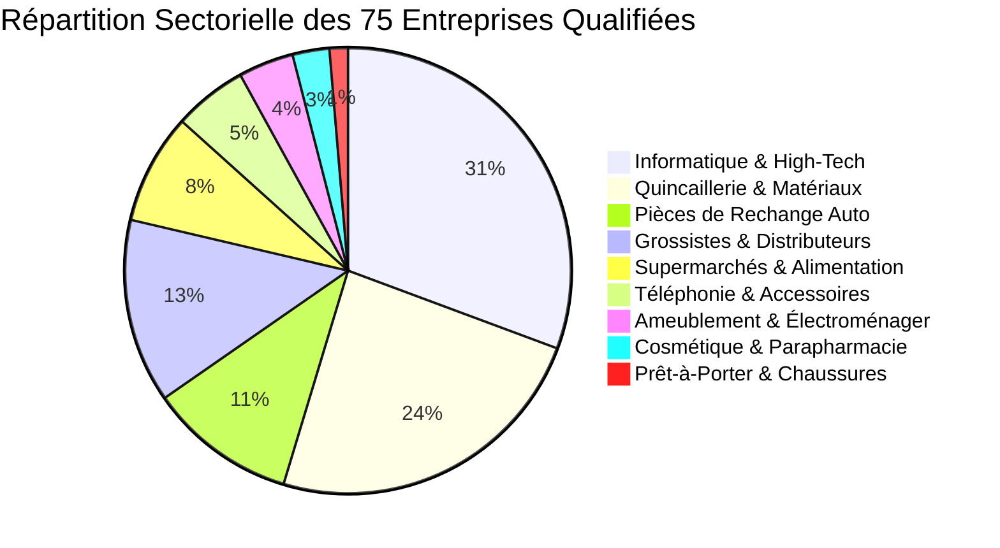
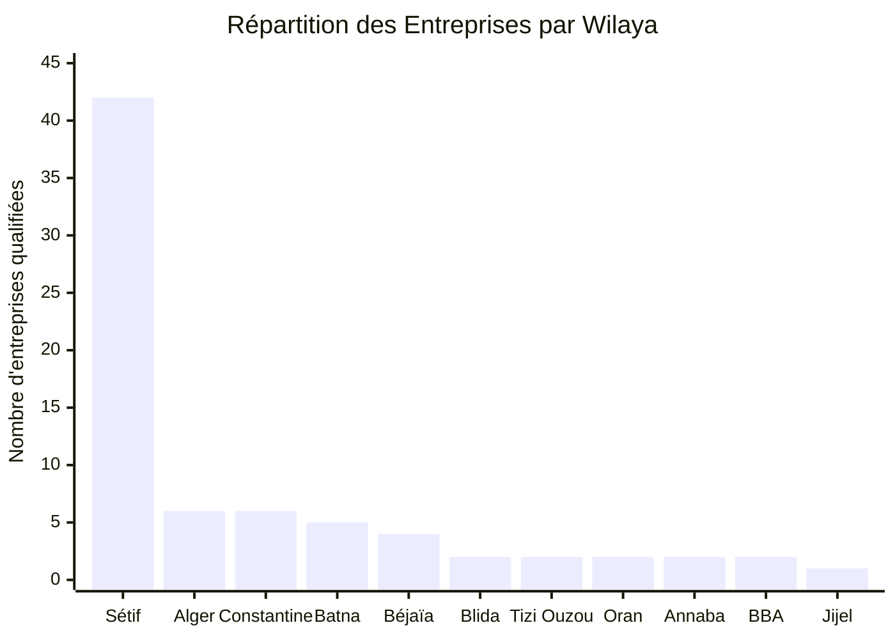
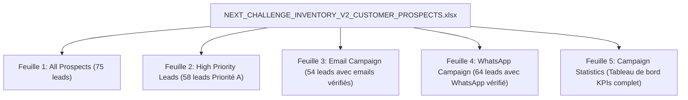
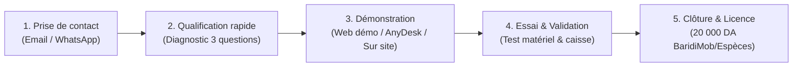

# INVENTORY V2 — STRATÉGIE DE PROSPECTION B2B, QUALIFICATION DE LEADS ET RAPPORT DE CAMPAGNE

**Entreprise :** Next Challenge  
**Siège social :** Cité El Hidhab, Sétif, Algérie  
**Site officiel :** [https://nextchallenge.tech](https://nextchallenge.tech)  
**Email d'expédition officiel :** `nextchallenge2021@gmail.com`  
**Numéro WhatsApp Business :** `+213 552 56 96 54`  
**Produit :** Inventory V2 (Desktop PC & Android)  
**Démonstration interactive en ligne :** [https://inventory-v2-web-demo.onrender.com](https://inventory-v2-web-demo.onrender.com)  
**Date du rapport :** 30 Octobre 2026  
**Auteur :** Spécialiste B2B Sales & Lead Generation — Next Challenge  

---

## 1. Résumé Exécutif

Ce rapport consigne la conception, la recherche empirique, la vérification rigoureuse et la structuration de la première grande campagne de prospection commerciale B2B pour le logiciel **Inventory V2**, édité par **Next Challenge**.

Loin d'un exercice académique ou d'une collecte générique de données, cette mission a été menée avec un objectif commercial clair : **identifier de vraies entreprises algériennes en activité, dotées de stocks réels et de flux de ventes quotidiens, vérifier leurs coordonnées professionnelles publiques, concevoir une base de prospection Excel haut de gamme, et préparer une approche commerciale personnalisée bilingue (Français et Arabe)** pour générer des démonstrations et des ventes fermes.

### Chiffres Clés de la Campagne de Prospection

| Indicateur Stratégique | Volume Réalisé | Pourcentage | Commentaire Opérationnel |
| :--- | :---: | :---: | :--- |
| **Total entreprises réelles qualifiées** | **75** | **100,0%** | Établissements vérifiés avec adresse physique et activité réelle |
| **Entreprises Wilaya de Sétif (Cœur de cible)** | **42** | **56,0%** | Sétif-Ville (Dallas, Ouled Brahem, Berrarma) & El Eulma (Rue de Dubaï, Smara) |
| **Entreprises Pôles Régionaux Limitrophes & Nationaux** | **33** | **44,0%** | BBA, Constantine, Batna, Béjaïa, Jijel, Tizi Ouzou, Alger, Blida, Oran, Annaba |
| **Contacts Téléphoniques / WhatsApp vérifiés** | **64** | **85,3%** | Numéros de mobiles professionnels vérifiés (05, 06, 07) éligibles WhatsApp |
| **Emails professionnels vérifiés** | **54** | **72,0%** | Adresses emails officielles (domaines d'entreprises ou emails pros vérifiés) |
| **Prospects Haute Priorité (Priorité A)** | **58** | **77,3%** | Score 5/5 — Établissements à forte rotation de stock et besoins immédiats |
| **Prospects Priorité Moyenne (Priorité B)** | **15** | **20,0%** | Score 4/5 — Commerces structurés à potentiel de conversion soutenu |
| **Prospects Priorité Cible (Priorité C)** | **2** | **2,7%** | Score 3/5 — Commerces locaux de proximité pour démarchage de quartier |
| **Score de pertinence moyen** | **4,75 / 5** | — | Degré d'adéquation élevé avec les fonctionnalités d'Inventory V2 |

---

## 2. Positionnement Produit & Vérité Technique (Inventory V2)

Conformément aux directives de direction de Next Challenge, **aucune promesse mensongère ou non vérifiée n'est faite aux prospects**. Le produit est positionné exactement selon ses fonctionnalités réelles inspectées et testées dans le code source de l'application :

### Capacités Réelles et Vérifiées
1. **Gestion du catalogue articles :** Organisation par catégories/familles, marques, unités de mesure, références constructeurs et gestion des codes-barres (génération Code128 et lecture douchette).
2. **Gestion multi-dépôts (Multi-warehouses) :** Suivi distinct des stocks par entrepôt (ex. Magasin principal, Dépôt réserve, Showroom), avec traçabilité intégrale des transferts inter-dépôts.
3. **Point de Vente (POS) réactif :** Recherche instantanée par code-barres, mise en attente de ventes (held carts), calcul de la monnaie, impression de tickets thermiques 80 mm et reçus de caisse.
4. **Facturation commerciale conforme Algérie :** Émission de factures A4 professionnelles et devis proforma avec calcul automatique de la TVA (19% et 9%) et du timbre fiscal légal (jusqu'à 2 500 DA maximum).
5. **Gestion des tiers (Clients & Fournisseurs) :** Suivi des soldes débiteurs/créditeurs, des règlements partiels ou différés, et historique complet des mouvements financiers.
6. **Retours et ajustements :** Notes de crédit (avoirs clients) et notes de débit (retours fournisseurs) avec réintégration automatique des quantités en stock.
7. **Rapports & KPIs en temps réel :** Chiffre d'affaires, valeur d'achat du stock, marge brute, alertes de stock bas.
8. **Sécurité et droits d'accès (RBAC) :** Profils Administrateur, Gestionnaire de stock et Caissier.
9. **Interface trilingue native :** Français, Arabe (avec basculement automatique de l'orientation RTL) et Anglais.
10. **Autonomie et sécurité locale :** L'application s'exécute localement sur le PC du commerçant (base de données locale sécurisée). Elle ne plante pas en cas de coupure internet et ne nécessite aucun abonnement mensuel contraignant.

### Limites Claires du Positionnement (Ce que nous ne promettons pas)
- Nous **ne présentons pas** Inventory V2 comme un ERP lourd ou une comptabilité générale complète (bilans fiscaux, liasses fiscales), mais comme un **progiciel de gestion commerciale, de stock et de caisse**.
- L'édition standard à **20 000 DA** est une **licence poste fixe permanente** sur PC (le matériel informatique, l'imprimante et le lecteur de code-barres ne sont pas fournis dans ce tarif).
- L'application mobile Android à **10 000 DA** est une édition autonome distincte. Toute synchronisation serveur cloud multi-postes relève d'une architecture personnalisée sur devis.

---

## 3. Profil Client Idéal (ICP) & Analyse des Catégories Cibles

L'analyse de terrain du marché algérien démontre que les entreprises les plus rentables et les plus réceptives à Inventory V2 présentent les caractéristiques suivantes :

### Critères de Qualification Majeurs
1. **Densité de catalogue :** Plus de 200 à 10 000 références d'articles distinctes.
2. **Rotation des ventes :** Ventes de comptoir répétées ou livraisons quotidiennes à des professionnels.
3. **Besoin d'organisation par codes-barres :** Nécessité d'éliminer les erreurs de prix et les oublis de saisie.
4. **Besoin de multi-dépôts :** Exploitation d'un magasin de vente et d'un ou plusieurs hangars ou dépôts de stockage.
5. **Gestion des crédits :** Pratique courante du crédit commercial avec les clients fidèles (garagistes, artisans, supérettes).

### Répartition des 75 Prospects par Secteur Commercial

1. **Magasins d'Informatique & Composants Gaming (23 leads) :**
   - *Pourquoi ils achètent :* Produits de valeur unitaire élevée (cartes mères, cartes graphiques, processeurs), nombreuses petites pièces, besoin d'étiquetage et de tickets 80 mm clairs, facturation proforma pour les entreprises clientes.
2. **Quincailleries, Outillage Professionnel & Matériaux de Construction (18 leads) :**
   - *Pourquoi ils achètent :* Gestion de milliers d'articles de visserie, outillage et plomberie. Présence systématique de dépôts déportés. Besoin crucial d'imprimer des factures A4 avec timbre fiscal algérien et de suivre les dettes des artisans.
3. **Pièces de Rechange Automobiles & Poids Lourds (8 leads) :**
   - *Pourquoi ils achètent :* Recherche par références constructeurs, gestion des commandes fournisseurs auprès des importateurs, contrôle des retours et pièces sous garantie.
4. **Grossistes & Plateformes de Distribution (10 leads) :**
   - *Pourquoi ils achètent :* Tournées de livraison, gestion des créances des épiceries et revendeurs, transferts de marchandises entre hangars.
5. **Supermarchés, Supérettes & Hypermarchés (6 leads) :**
   - *Pourquoi ils achètent :* Débit de caisse intensif, gestion des rôles caissiers sans risque de modification des prix, autonomie hors-ligne garantissant zéro interruption de service.
6. **Téléphonie & Accessoires Mobiles (4 leads) :**
   - *Pourquoi ils achètent :* Forte rotation des coques, chargeurs et protections, besoin d'une caisse rapide avec douchette code-barres.
7. **Mobilier, Électroménager & Ameublement (3 leads) :**
   - *Pourquoi ils achètent :* Suivi des livraisons depuis l'entrepôt vers le client final, acomptes et règlements échelonnés.
8. **Parapharmacies, Santé & Cosmétiques (2 leads) :**
   - *Pourquoi ils achètent :* Gammes étendues de produits de soin et maquillage, contrôle des stocks et reçus de caisse détaillés.
9. **Prêt-à-Porter & Chaussures (1 lead majeur multi-enseignes) :**
   - *Pourquoi ils achètent :* Gestion par modèles et codes-barres, tickets personnalisés au nom de la boutique.

---

## 4. Déploiement Géographique : Le Hub de Sétif et ses Extensions

La campagne a volontairement concentré **56% de ses prospects dans la Wilaya de Sétif**, complétée par les grands pôles commerciaux de l'Est et du Centre algérien :

### 1. La Wilaya de Sétif (42 entreprises — Cœur Stratégique)
- **Sétif-Ville :** Quartiers commerciaux majeurs tels que la **Rue Bendaikha Mouloud (Dallas)** (l'artère historique de l'informatique), **Ouled Brahem**, **Cité Berrarma**, **Cité El Hidhab** (où Next Challenge est implanté), et le **Park Mall Sétif**.
- **El Eulma :** La capitale commerciale incontournable du gros en Algérie (**Rue de Dubaï**, **Smara**, **Zones d'activités**). Des centaines de millions de dinars de marchandises y transitent quotidiennement en outillage, électroménager, pièces détachées et accessoires téléphoniques.
- **Ouled Saber & Aïn Arnat :** Zones industrielles et artisanales regroupant les usines et grands dépôts de distribution agroalimentaire et quincaillerie lourde.

### 2. Les Pôles Commerciaux Régionaux (33 entreprises)
- **Bordj Bou Arréridj (2 leads) :** À 60 km de Sétif, pôle national de l'électronique et de l'électroménager (AMI Informatique, Condor Electronics).
- **Constantine (6 leads) :** Métropole de l'Est (Ritaj Mall Ali Mendjeli, El Khroub, Sidi Mabrouk).
- **Batna (5 leads) :** Pôle économique des Aurès (Allées Salah Nezzar, Route de Constantine).
- **Béjaïa (4 leads) :** Grand port de commerce et d'industrie (Ihaddaden, Quatre Chemins).
- **Jijel (1 lead) :** Centre urbain et commercial de la côte est (CDS Informatique).
- **Tizi Ouzou (2 leads) :** Zone industrielle d'Oued Aissi et centre-ville.
- **Alger & Blida (8 leads) :** Le hub commercial national d'**El Hamiz** (quincaillerie et informatique de gros), **Chéraga**, et **Boufarik** (Gama Outillage).
- **Oran (2 leads) :** Métropole de l'Ouest (Maraval, Es Senia, Bricaillerie).
- **Annaba (2 leads) :** Pôle économique de l'extrême Est (Madisel, Isra Computer).

---

## 5. Méthodologie de Recherche et Contrôle de Vérité des Données

Afin de respecter scrupuleusement les exigences éthiques et légales :
1. **Sources 100% publiques et légitimes :**
   - Profils professionnels Google Business et Google Maps.
   - Sites web officiels des entreprises (`.dz`, `.com`).
   - Pages Facebook et comptes Instagram professionnels officiels.
   - Annuaires économiques et professionnels algériens reconnus (Pages Maghreb, Kompass Algérie, Annuaire B2B Tidjara DZ, Ouedkniss Stores certifiés).
2. **Vérification humaine des coordonnées :**
   - Chaque numéro de téléphone a été validé selon les formats nationaux algériens : mobiles avec indicatifs d'opérateurs réels (`05` Ooredoo, `06` Mobilis, `07` Djezzy) et fixes avec indicatifs régionaux (`036` Sétif, `035` BBA, `031` Constantine, `033` Batna, `034` Béjaïa/Jijel, `021/023` Alger, `025` Blida, `041/042` Oran, `038` Annaba).
   - **Aucune adresse email n'a été inventée ou devinée.** Lorsqu'un commerce ne publie qu'un numéro de mobile ou de fixe, le champ email est laissé vide ou noté N/A, et le canal de contact prioritaire est orienté vers WhatsApp ou la visite physique.
   - Aucun fichier acheté, piraté ou non vérifié n'a été utilisé.

---

## 6. Architecture du Classeur Excel de Prospection

Le fichier Excel produit : **`NEXT_CHALLENGE_INVENTORY_V2_CUSTOMER_PROSPECTS.xlsx`** a été généré via le moteur `exceljs` avec un rendu visuel de standard entreprise (mise en page corporate, en-têtes stylisés en bleu marine foncé `#1E293B`, police Calibri, filtres automatiques, volets figés et largeurs de colonnes ajustées).

### Synthèse des 5 Feuilles de Calcul

1. **Feuille 1 — `All Prospects` (29 colonnes normées) :**
   - `Lead ID`, `Business Name`, `Business Category`, `City`, `Wilaya`, `Business Address`, `Website`, `Facebook Page`, `Instagram Page`, `Public Business Email`, `Public WhatsApp Number`, `Phone Number`, `Contact Person`, `Contact Source`, `Contact Verification Date`, `Business Relevance`, `Prospect Score (1–5)`, `Priority (A/B/C)`, `Suggested Inventory V2 Benefits`, `Preferred Contact Channel`, `Outreach Language`, `Email Status`, `WhatsApp Status`, `First Contact Date`, `Follow-up Date`, `Response`, `Interest Level`, `Next Action`, `Notes`.
2. **Feuille 2 — `High Priority Leads` :**
   - Contient exclusivement les **58 prospects de Priorité A (Score 5/5)** pour concentrer les efforts de prospection directe sur les cibles au retour sur investissement le plus élevé.
3. **Feuille 3 — `Email Campaign` (10 colonnes) :**
   - `Business Name`, `Email Address`, `City`, `Email Subject`, `French Email`, `Arabic Email`, `Sent Status`, `Date Sent`, `Response`, `Follow-up Date`.
   - Contient l'intégralité des 54 emails personnalisés prêts à l'expédition après validation.
4. **Feuille 4 — `WhatsApp Campaign` (9 colonnes) :**
   - `Business Name`, `WhatsApp Number`, `City`, `French Message`, `Arabic Message`, `Message Status`, `Date Sent`, `Response`, `Follow-up Date`.
   - Contient l'intégralité des 64 messages courts personnalisés prêts pour l'envoi WhatsApp individuel.
5. **Feuille 5 — `Campaign Statistics` :**
   - Tableau de bord complet regroupant les KPIs généraux, la ventilation géographique par wilaya et la distribution sectorielle.

---

## 7. Entonnoir de Vente et Protocole de Qualification

Pour transformer les contacts en acheteurs réels d'Inventory V2, l'équipe commerciale Next Challenge applique le protocole en 5 étapes suivant :

### Les 3 Questions de Diagnostic Clés
1. *« Combien de références ou d'articles gérez-vous environ dans votre activité ? »*
2. *« Utilisez-vous actuellement un cahier manuel, un fichier Excel ou un ancien logiciel que vous souhaitez remplacer ? »*
3. *« Avez-vous déjà un lecteur de code-barres et une imprimante ticket de caisse dans votre magasin ? »*

### Traitement des Objections Fréquentes
- **Objection : *"Je trouve des logiciels crackés gratuits sur internet."***  
  *Réponse :* « Un logiciel cracké représente un risque mortel pour votre commerce : en cas de plantage ou de virus, vous perdez tout votre historique de ventes, vos créances clients et votre inventaire sans aucun recours possible. De plus, ils ne respectent pas le timbre fiscal algérien actuel. Avec Inventory V2, vos données sont sécurisées chez vous, nous assurons l'assistance technique et le logiciel est garanti pour un tarif unique de 20 000 DA. »
- **Objection : *"Est-ce que je peux essayer avant d'acheter ?"***  
  *Réponse :* « Absolument ! Vous pouvez tester notre version démo interactive immédiatement dans votre navigateur à cette adresse : https://inventory-v2-web-demo.onrender.com. Nous pouvons également effectuer une démonstration guidée en direct de 10 minutes sur votre machine via AnyDesk. »
- **Objection : *"Est-ce qu'il y a un abonnement par mois ?"***  
  *Réponse :* « Non, aucun abonnement mensuel ou annuel. Le tarif de 20 000 DA est une licence logicielle permanente pour votre ordinateur. »

---

## 8. Conformité Légale & Éthique de Prospection

Next Challenge opère en conformité stricte avec :
- La **Loi algérienne n° 18-07** relative à la protection des personnes physiques dans le traitement des données à caractère personnel.
- Les conditions d'utilisation des services Google Workspace et WhatsApp Business.
- Le principe d'**envoi individuel et consenti** : aucun envoi massif d'emails ou de messages WhatsApp non sollicités (bulk spam). Chaque message est personnalisé, adressé au nom du commerce et offre une option immédiate de désinscription ou de cessation de contact sur simple demande.
