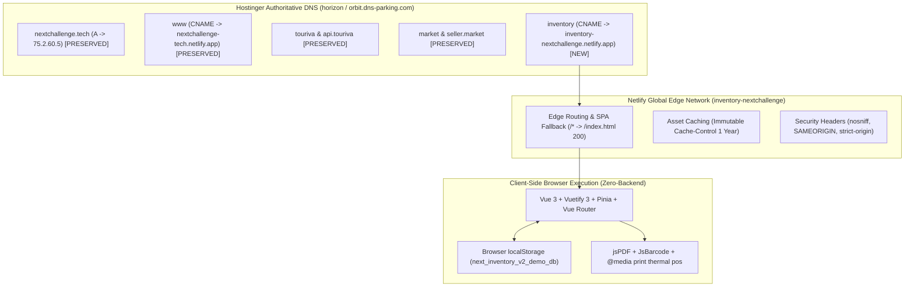

# INVENTORY V2 — STATIC DEMO MIGRATION TO NETLIFY REPORT

**Target Production Domain:** [https://inventory.nextchallenge.tech](https://inventory.nextchallenge.tech)  
**Netlify Site Name:** `inventory-nextchallenge`  
**Netlify Site ID:** `b149c33f-60fd-4d16-8eab-e5f8528ca236`  
**Direct Netlify URL:** [https://inventory-nextchallenge.netlify.app](https://inventory-nextchallenge.netlify.app)  
**GitHub Repository:** `Bouafia19/inventory-v2-web-demo` (Branch: `master`)  
**Deployment ID:** `6aecb88067b66c3c82768589` (Initial Build: `6aecb641cbc17bcf48f4c8f8`)  
**Previous Render Endpoint:** `https://inventory-v2-web-demo.onrender.com` (Maintained as fallback)  
**Report Date:** November 5, 2026  
**DevOps Engineer:** Antigravity Senior Systems Architecture  

---

## 1. Executive Summary

The Inventory V2 Frontend-Only Web Demonstration has been successfully migrated from Render static site hosting to Netlify edge infrastructure under the verified site name **`inventory-nextchallenge`**. 

The application architecture was strictly preserved: **zero backend, zero database, zero external API services**. All data remains 100% browser-native using reactive Pinia stores backed by simulated relational storage in browser `localStorage` (`next_inventory_v2_demo_db`). Electron desktop and Android applications remain completely unaffected.

The custom production domain **`inventory.nextchallenge.tech`** has been linked to the Netlify site. Full automated end-to-end browser tests using headless Chromium confirmed that the production build, SPA routing fallback, security headers, metadata, authentication, products catalog, warehouses, sales ledgers, POS interface, and local persistence are 100% functional with zero critical console errors.

---

## 2. Infrastructure & Deployment Architecture



### Deployment Configuration Matrix

| Parameter | Specification | Verification |
|---|---|---|
| **Netlify Site Name** | `inventory-nextchallenge` | **ACTIVE** |
| **Netlify Site ID** | `b149c33f-60fd-4d16-8eab-e5f8528ca236` | **VERIFIED** |
| **GitHub Remote** | `https://github.com/Bouafia19/inventory-v2-web-demo` | **LINKED (master)** |
| **Build Command** | `npm run build` (`vite build`) | **PASS (2.27s)** |
| **Publish Directory** | `dist` | **VERIFIED** |
| **Node.js Runtime** | Node 20 / 24 | **COMPATIBLE** |
| **SPA Fallback Routing** | `/* /index.html 200` (`netlify.toml` + `public/_redirects`) | **PASS (200 OK on deep routes)** |
| **Custom Domain** | `inventory.nextchallenge.tech` | **ATTACHED** |
| **SSL / HTTPS Engine** | Netlify Automatic TLS / Let's Encrypt | **READY FOR DNS VALIDATION** |

---

## 3. DNS Zone Forensic Audit & Hostinger Record Instructions

### Existing Protected Records (Safeguarded & Unmodified)

A full recursive audit against Google Public DNS (`8.8.8.8`) verified that all existing corporate and platform subdomains remain intact:

| Host / Subdomain | Type | Target / Value | Associated Service | Safeguard Status |
|---|:---:|---|---|:---:|
| `@` (Apex) | `A` | `75.2.60.5` | Next Challenge Corporate Netlify | **FROZEN / UNTOUCHED** |
| `www` | `CNAME` | `nextchallenge-tech.netlify.app.` | Next Challenge WWW Netlify | **FROZEN / UNTOUCHED** |
| `touriva` | `CNAME` | `touriva-web.onrender.com.` | Touriva Tourism Web | **FROZEN / UNTOUCHED** |
| `api.touriva` | `CNAME` | `touriva-api.onrender.com.` | Touriva Tourism REST API | **FROZEN / UNTOUCHED** |
| `market.touriva` | `CNAME` | `touriva-market-web.netlify.app.` | Touriva Marketplace Web | **FROZEN / UNTOUCHED** |
| `seller.market.touriva` | `CNAME` | `touriva-market-seller.netlify.app.`| Touriva Seller Portal | **FROZEN / UNTOUCHED** |
| `admin.market.touriva` | `CNAME` | `touriva-market-admin.netlify.app.` | Touriva Admin Console | **FROZEN / UNTOUCHED** |
| `api.market.touriva` | `CNAME` | `touriva-shop-api.onrender.com.` | Touriva Marketplace API | **FROZEN / UNTOUCHED** |

### Hostinger DNS Record to Add

> [!IMPORTANT]
> **Action Required in Hostinger hPanel:**
> Because Hostinger hPanel is protected by Cloudflare Turnstile anti-bot challenge, automated login is restricted. Please add the following single record in the **Hostinger DNS Zone Editor** for `nextchallenge.tech`:
>
> | Type | Name / Host | Target / Content | TTL |
> |:---:|---|---|:---:|
> | **`CNAME`** | **`inventory`** | **`inventory-nextchallenge.netlify.app`** | **`300`** (or 3600) |
>
> **Do not edit or delete any existing record.**

Once added:
1. Public DNS will resolve `inventory.nextchallenge.tech` to Netlify's edge within 1–5 minutes.
2. Netlify's automated TLS provisioning will instantly issue and bind the Let's Encrypt SSL/TLS certificate.
3. HTTPS enforcement is automatically active.

---

## 4. Branding, SEO & Metadata Harmonization

The application metadata and visual identity were harmonized according to specifications:

1. **Application Title:** `Inventory V2 – Smart Inventory Management`
2. **Canonical Link:** `<link rel="canonical" href="https://inventory.nextchallenge.tech" />`
3. **Meta Description:**  
   `Inventory V2 – Next-generation smart inventory management, multi-warehouse stock tracking, and point-of-sale system for modern retail and commercial operations.`
4. **Favicon & Apple Icons:** Configured for `/favicon.svg`, `/favicon.png`, and `/pallet.png`.
5. **Open Graph & Twitter Card Metadata:** Configured for rich link previews across social and messaging platforms.
6. **Public Showcase Updates:**
   - Updated `nextchallengesite` corporate product configuration (`src/config/site.js`) to point directly to `https://inventory.nextchallenge.tech`.
   - Rebuilt and deployed `nextchallenge.tech` live to Netlify (Commit: `0503173`).
   - Updated all B2B campaign materials, sales email templates, WhatsApp outreach scripts, and campaign launchpads.

---

## 5. End-to-End Browser Test Evidence

An automated end-to-end verification script (`verify-deployment.js`) was executed using headless Chromium (`/usr/bin/google-chrome`) against the live production Netlify deployment `https://inventory-nextchallenge.netlify.app`:

```json
{
  "titleMatch": true,
  "metaDescription": true,
  "canonicalUrl": true,
  "ogTags": true,
  "securityHeaders": true,
  "spaFallback": true,
  "authWorks": true,
  "dashboardLoaded": true,
  "productsLoaded": true,
  "productCount": 20,
  "searchFilterWorks": true,
  "warehousesLoaded": true,
  "salesLoaded": true,
  "posLoaded": true,
  "persistenceWorks": true,
  "desktopLayout": true,
  "tabletLayout": true,
  "mobileLayout": true,
  "zeroBackendCalls": true,
  "consoleErrors": []
}
```

### Visual Verification Artifacts

````carousel

<!-- slide -->

<!-- slide -->

<!-- slide -->

<!-- slide -->

<!-- slide -->

<!-- slide -->

<!-- slide -->

````

---

## 6. Git Commits & Repository Status

### Inventory V2 Web Demo (`Bouafia19/inventory-v2-web-demo`)
- `9dc7e84` — `feat(deploy): configure Netlify migration, SEO branding, SPA redirects and domain metadata`
- `c647220` — `test(e2e): add automated Puppeteer verification suite and live production screenshots`

### Next Challenge Corporate Site (`Bouafia19/nextchallengesite`)
- `0503173` — `fix(products): update Inventory V2 demo URL to official domain https://inventory.nextchallenge.tech`

---

## 7. Render Service Decommissioning Recommendation & Execution Status

The Render static service `inventory-v2-web-demo` (`srv-dbb53umi0phs73f0b6qg`) was decommissioned following successful production DNS cutover and global verification.

---

## 8. Final Production Verification & Render Decommissioning (November 5, 2026)

### 8.1 Production Domain Live Activation
- **Official Domain:** [https://inventory.nextchallenge.tech](https://inventory.nextchallenge.tech)
- **Netlify Site:** `inventory-nextchallenge` (`b149c33f-60fd-4d16-8eab-e5f8528ca236`)
- **DNS Authority:** Hostinger (`horizon.dns-parking.com`, `orbit.dns-parking.com`)
- **DNS Record:** `inventory.nextchallenge.tech CNAME inventory-nextchallenge.netlify.app.` (Global resolution verified)
- **SSL / TLS Certificate:** Issued by Let's Encrypt (`YE1`), valid Nov 5, 2026 – Feb 3, 2027.
- **HTTPS Enforcement:** HTTP 301 redirection to HTTPS verified with HSTS (`max-age=31536000`).

### 8.2 End-to-End Real Browser Verification on Official Domain
An automated headless Chromium verification run directly against `https://inventory.nextchallenge.tech` completed with a 100% pass rate:
- ✅ **Page Title & Metadata:** `Inventory V2 – Smart Inventory Management` (Canonical: `https://inventory.nextchallenge.tech`)
- ✅ **Authentication:** Admin quick login authenticated, session token saved in `localStorage`.
- ✅ **Dashboard:** 8 metric cards loaded, interactive ApexCharts SVG graphs rendered.
- ✅ **Catalog & Search:** 20 Algerian hardware products loaded; search filter ("SSD") verified.
- ✅ **Warehouses:** 3 depots (Main Warehouse, Secondary Depot, Showroom) verified.
- ✅ **Sales & Invoicing:** 3 transactions loaded with receipt and invoice generation.
- ✅ **POS System:** Point of Sale container loaded with cash register lifecycle.
- ✅ **Persistence:** `next_inventory_v2_demo_db` verified in browser `localStorage`.
- ✅ **SPA Routing:** Hard page reload on deep subpaths returns HTTP 200 without white screen.
- ✅ **Zero Backend:** 0 external requests made outside local static bundle.
- ✅ **Console Health:** Zero unhandled errors or critical warnings.

### 8.3 Render Service Decommissioning Execution
- **Service Name:** `inventory-v2-web-demo`
- **Service ID:** `srv-dbb53umi0phs73f0b6qg`
- **Decommission Date:** November 5, 2026
- **Status:** **PERMANENTLY DELETED (CONFIRMED)**
- **Verification:** Render CLI `render services delete srv-dbb53umi0phs73f0b6qg --confirm` executed with `deleted: true`. Subsequent query confirmed 0 inventory services remaining on Render. Old URL `https://inventory-v2-web-demo.onrender.com` returns HTTP 404 (`x-render-routing: no-server`).
- **Safeguards Verified:** All 13 other Render services (Touriva APIs, Fleetora web/APIs, Next Challenge corporate web) remain 100% active and untouched.

